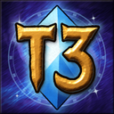
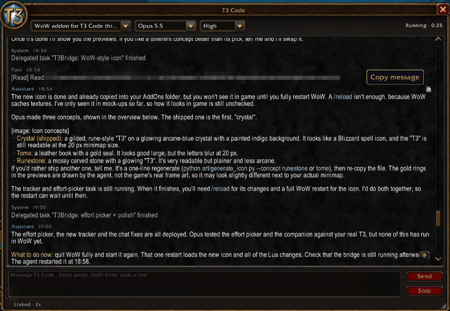
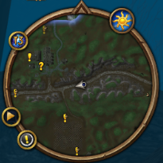
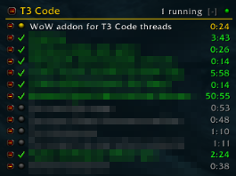
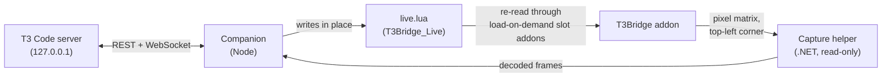

<p align="center">
  
</p>

<h1 align="center">YetAnotherT3Wow</h1>

<p align="center">
  <b>Your T3 Code threads, inside World of Warcraft.</b><br>
  A WoW addon and a small Windows companion that show your coding-agent threads in a quest-style tracker and let you chat with them from a native-looking window.
</p>

<p align="center">
  
  
  
  
  
  <br>
  
  
  
</p>

<p align="center">
  <a href="#setup">Setup</a> · <a href="#how-it-works">How it works</a> · <a href="#commands">Commands</a> · <a href="docs/TROUBLESHOOTING.md">Troubleshooting</a> · <a href="#safety">Safety</a>
</p>

> [!NOTE]
> **Beta.** Tested on one client only: WoW Forever 1.60.1 (flavour `_forever_`, interface 16001). Other flavours are untested.
> Windows 10/11 only. This is an unofficial hobby project, not affiliated with Blizzard Entertainment or T3 Tools.

## Features

- **Live tracker under Questie.** Every open T3 thread with its state (running, needs you, done, failed) and a ticking timer.
- **Native-style chat window.** Switch threads, read replies with light markdown, send messages with Enter.
- **Model and effort pickers.** Change the thread's model and reasoning effort from the window's dropdowns.
- **Collapsible rows.** Right-click a row (or its +/−) to fold it; rows that need you expand again by themselves.
- **Approvals and questions.** Allow / deny tool requests and answer agent questions in game.
- **Images.** Pictures in a thread show inline (click to enlarge). Attach a copied image (Ctrl+V in the message box, or the Attach button) or your latest WoW screenshot.
- **Minimap button.** Opens the window; finds a free spot on the ring and can be dragged.
- **No screen flash.** Outgoing commands are a tiny black-and-white strip in the top-left corner (2 px cells, about 0.2 s), only when you act.
- **Local only.** The companion talks to T3 Code on `127.0.0.1` and nothing else.

<table>
  <tr>
    <td width="70%"></td>
    <td><br></td>
  </tr>
  <tr>
    <td>Chat window: thread, model (<code>Opus 5.5</code>) and effort (<code>High</code>) pickers, live status.</td>
    <td>Minimap button (upper left of the ring) and the tracker under Questie, with live timers.</td>
  </tr>
</table>

## How it works



WoW addons cannot open sockets or read files at will. Inbound, the companion rewrites one padded Lua file in place; the addon loads it again through one of 500 tiny load-on-demand "slot" addons that all point at the same file (NTFS hard links). Outbound, the addon draws a short matrix of black and white cells in the corner of the screen, and the capture helper reads that strip with Windows.Graphics.Capture and hands it to the companion, which runs the command against T3. Details: [docs/ARCHITECTURE.md](docs/ARCHITECTURE.md) and the wire contract in [protocol/PROTOCOL.md](protocol/PROTOCOL.md).

## Setup

**You need:** Windows 10 or 11 · WoW Forever installed · T3 Code (the desktop app) running · [Node.js 22+](https://nodejs.org) · [.NET SDK 7 or newer](https://dotnet.microsoft.com/download) (8 is fine) for the capture helper · Python 3 only for the developer tests.

Run these in PowerShell. If scripts are blocked, prefix them with `powershell -ExecutionPolicy Bypass -File`.

1. **Clone** the repo.
   ```powershell
   git clone https://github.com/luminalmvm/YetAnotherT3Wow.git
   cd YetAnotherT3Wow
   ```
2. **Build the companion.**
   ```powershell
   cd companion; npm install; npm run build; cd ..
   ```
3. **Build the capture helper.**
   ```powershell
   dotnet build -c Release capture-helper\T3Capture
   ```
4. **Authorise the companion with T3 Code** (T3 Code must be running). This asks T3's own CLI for a scoped, revocable token (`orchestration:read` + `orchestration:operate`, 90 days) and stores it DPAPI-encrypted in `%LOCALAPPDATA%\T3Bridge\bearer.dat`. The token is never printed.
   ```powershell
   node companion\dist\main.js --login
   node companion\dist\main.js --status     # checks discovery, credential and paths
   ```
   If `--login` cannot find the T3 CLI (`%USERPROFILE%\.t3\bin\t3.cmd`), create a one-time pairing token with `t3 pair --scope orchestration:read --scope orchestration:operate` and paste it into `node companion\dist\main.js --pair` (it reads the token from standard input). More in [docs/t3-api-notes.md](docs/t3-api-notes.md#2-authentication).
5. **Close WoW**, then install the addon (it also creates 100 image slots, about 105 MB; `-ImageSlots 0` skips them). The script looks for your WoW folder (registry, Battle.net settings, common folders). Try `-WhatIf` first to see what it would do.
   ```powershell
   .\scripts\install-addon.ps1 -WhatIf
   .\scripts\install-addon.ps1
   # not found? point it at the folder that holds Interface\AddOns:
   .\scripts\install-addon.ps1 -WowPath "<drive>:\World of Warcraft\_forever_"
   ```
6. **Start WoW**, make sure *T3Bridge* is ticked in the AddOns list, log in. You should see the T3 button on the minimap. `/t3 demo` shows sample data without the bridge. Run `/t3 spike img` once to check image slots on your client (it guides you).
7. **Start the bridge.**
   ```powershell
   .\scripts\start-bridge.ps1            # hidden; add -Console for a log window
   ```
8. **Check the link.** In game, `/reload` once, then `/t3 status` should say `Link: Linked`, and the tracker lists your open threads. For a deeper self-test of the file link, keep `.\scripts\dev\set-live-file.ps1 -Spike -Loop` running in another window and type `/t3 spike s1`.
9. **Optional autostart** at Windows logon: `.\scripts\install-companion.ps1 -SkipBuild -NoLogin -Startup`.

Stop with `.\scripts\stop-bridge.ps1`: it also clears the live file, so no conversation text stays in your WoW folder.

<details>
<summary><b>Variants and advanced options</b></summary>

- `install-addon.ps1 -Slots 2000` gives longer sessions before "Link low: click to reload" (each poll uses one slot).
- `-ImageSlots 200` allows more pictures per WoW session; `-ImageSlots 0` turns inline images off (they show as `[image: name]`; attaching still works).
- `-Variant A` makes slot TOCs point at `..\T3Bridge_Live\live.lua` instead of hard links (for file systems without hard links).
- `-Flavor _classic_era_` (or any flavour folder) targets another client. Untested.
- `scripts\install-companion.ps1` does steps 2–4 in one go and writes `%LOCALAPPDATA%\T3Bridge\config.json` (every key: [companion/src/config.ts](companion/src/config.ts)). The WoW folder can also come from the `T3B_WOW_PATH` environment variable.
- After changing addon files, `scripts\sync-addon.ps1` copies only changed files into the installed addon (safe while WoW runs), then `/reload`.
</details>

<details>
<summary><b>Uninstall</b></summary>

```powershell
.\scripts\stop-bridge.ps1
.\scripts\uninstall-addon.ps1                    # with WoW closed; removes only T3Bridge* folders
.\scripts\uninstall-companion.ps1 -RemoveData    # autostart, config, credential (revokes the T3 session)
```
Your settings stay in `WTF\Account\<account>\SavedVariables\T3Bridge.lua`; delete it if you like.
</details>

## Commands

| In game | What it does |
|---|---|
| `/t3` | Open or close the chat window (`/t3bridge` works too) |
| `/t3 help` | List commands |
| `/t3 demo` | Sample threads without the companion (again to leave) |
| `/t3 status` | Link, slot, snapshot and outbound details |
| `/t3 tracker on\|off\|reset\|auto\|below\|above\|free` | Show or place the tracker (`free`: Shift-drag the header) |
| `/t3 minimap on\|off\|reset` | Minimap button |
| `/t3 reset` | Reset window, tracker and minimap button positions |
| `/t3 cell 1\|2\|4` · `/t3 hold 100-500` | Outbound cell size (px) and how long each frame shows (ms) |
| `/t3 spike s1\|s1 combat\|s2\|fonts\|templates` | In-game self-tests |
| `/t3 spike img` | Guided image slot check (with `scripts\spike-image-slots.ps1`); `ok`/`fail` records the result |
| Ctrl+V · Attach button | Attach the copied image (e.g. Win+Shift+S) or the latest screenshot; sent with your next message |
| `/t3 reload` | Reload the UI to refill link slots |
| `/t3 debug` · `/t3 log` | Debug messages and recent debug lines |

| Script (`scripts\`) | What it does |
|---|---|
| `install-addon.ps1` / `uninstall-addon.ps1` | Install or remove the addon and its slots (`-WowPath`, `-Slots`, `-ImageSlots`, `-Variant`, `-WhatIf`) |
| `spike-image-slots.ps1` | Writes test colours for `/t3 spike img` while WoW runs (`-Step 2` for the `/reload` test) |
| `sync-addon.ps1` | Copy changed addon files into an installed addon |
| `start-bridge.ps1` / `stop-bridge.ps1` | Start (`-Console`, `-Demo`) or stop the companion (`-Clear` after a crash) |
| `install-companion.ps1` / `uninstall-companion.ps1` | Build, configure, authorise, autostart / remove |

## Safety

- **What it does:** draws UI with the normal addon API, reads a Lua file the companion writes, and draws a small cell matrix when you click or press Enter.
- **What it does not do:** no input injection, no key or mouse automation, no memory reading, no game file changes outside the T3Bridge addon folders. The addon never moves, targets or casts.
- **Capture is read-only:** the helper captures only the WoW window's top-left strip (1100×200 px by default) through Windows.Graphics.Capture, the same API screen recorders use.
- **Local only:** the companion connects to `127.0.0.1` only. The token is stored DPAPI-encrypted for your Windows user; the log never contains tokens or message text.
- **Privacy:** `live.lua` holds the open thread's text while the bridge runs, and is overwritten with an empty snapshot on stop; image slots are blanked on stop too.
- Unofficial and **use at your own risk**. Not affiliated with or endorsed by Blizzard Entertainment or T3 Tools.

## Known limitations

- Each poll uses one slot addon, so after a long session the addon asks you to `/reload` ("Link low").
- Exclusive fullscreen is untested; only maximised windowed mode was tested (borderless should behave the same).
- A changed icon texture needs a full WoW restart, not just `/reload`.
- T3 Code's local API is undocumented and nightly; an update can break the companion.
- Changing the model or effort in game changes the real T3 thread.
- Each image slot shows one picture per WoW session (WoW caches textures); after the last one, restarting WoW frees them all. Pictures are shown at most 512×512.
- Ctrl+V cannot paste the image itself into the message box (WoW pastes text only); it tells the companion to attach the clipboard image, which costs one short matrix flash.
- Image slots use about 105 MB of disk (100 × 1 MB TGA files).

## Repository

| Path | Contents |
|---|---|
| [`addon/T3Bridge`](addon/T3Bridge) | The WoW addon (Lua, XML) and its offline tests |
| [`companion`](companion) | Node/TypeScript companion: T3 client, live-file writer, frame decoder, image slots |
| [`capture-helper`](capture-helper) | .NET window-capture helper (also clipboard and image decoding) and a synthetic test window |
| [`protocol`](protocol) | Wire contract, fixtures and test vectors |
| [`scripts`](scripts) | Install, sync, start/stop; `scripts/dev` holds developer tools |
| [`docs`](docs) | [Architecture](docs/ARCHITECTURE.md), [development](docs/DEVELOPMENT.md), [troubleshooting](docs/TROUBLESHOOTING.md), [T3 API notes](docs/t3-api-notes.md) |
| [`art`](art) | Procedural icon generator and screenshot script |

## Contributing

Issues and pull requests are welcome. Read [CONTRIBUTING.md](CONTRIBUTING.md) first; the test commands are in [docs/DEVELOPMENT.md](docs/DEVELOPMENT.md).

## Licence

[MIT](LICENSE) © 2026 luminalmvm. The bundled DejaVu Sans Mono font has its own licence ([mono-LICENSE.txt](addon/T3Bridge/Media/mono-LICENSE.txt)).
